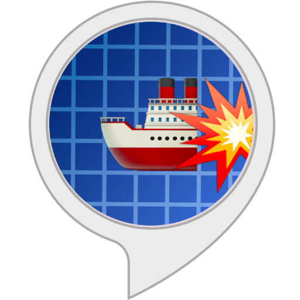
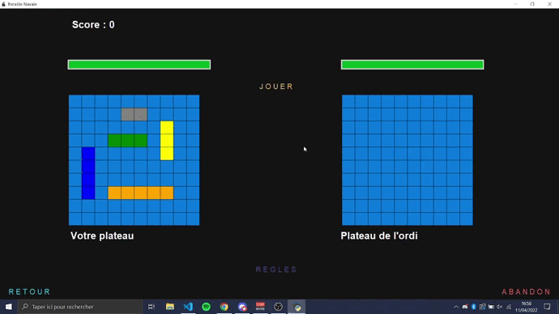
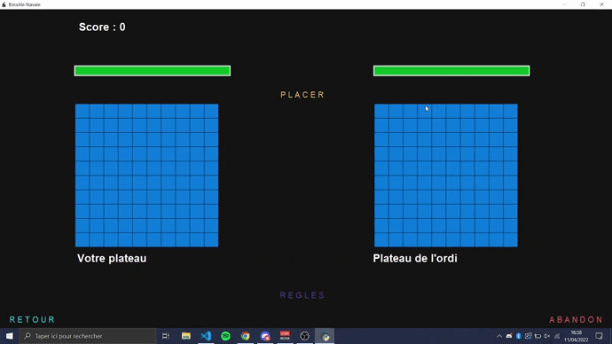
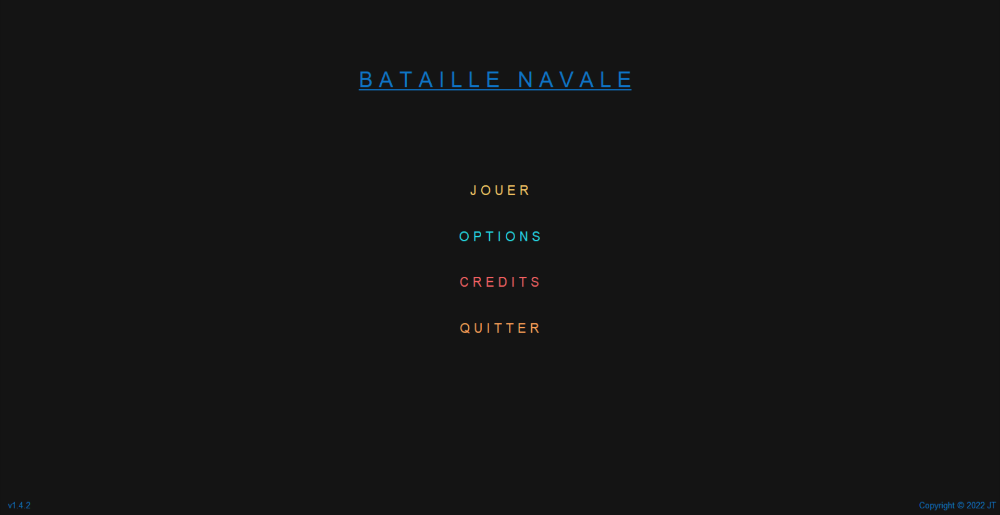
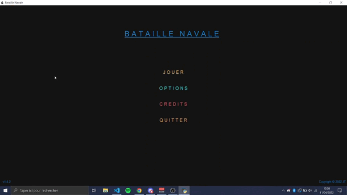
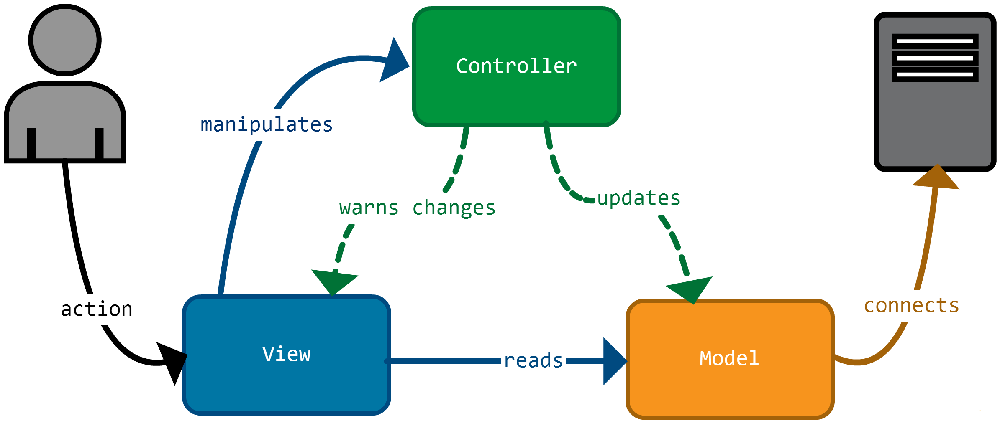

<p align="center">
  
</p>
<h1 align="center"> BattleShip L1 - Bataille Navale </h1>
<h3 align="center"> First Year (L1) Python Project - Tkinter Video Game </h3>
<h5 align="center"> Project Assignment - <a href="https://www.univ-jfc.fr/">Champollion University</a> (2022) - a full Battleship game against the computer, with its companion website </h5>

<div align="center">
  
  
  
  
  
</div>

<p align="center">
    
</p>

<!-- TABLE OF CONTENTS -->
<h2 id="table-of-contents"> :book: Table of Contents </h2>

<details open="open">
  <summary>Table of Contents</summary>
  <ol>
    <li><a href="#about-the-project"> ➤ About The Project</a></li>
    <li><a href="#features"> ➤ Features</a></li>
    <li><a href="#getting-started"> ➤ Getting Started</a></li>
    <li><a href="#how-to-play"> ➤ How to Play</a></li>
    <li><a href="#difficulty"> ➤ How the Computer Plays</a></li>
    <li><a href="#website"> ➤ Companion Website</a></li>
    <li><a href="#architecture"> ➤ Architecture</a></li>
    <li><a href="#structure"> ➤ Project Structure</a></li>
    <li><a href="#limitations"> ➤ Known Limitations</a></li>
    <li><a href="#credits"> ➤ Credits</a></li>
  </ol>
</details>


<!-- ABOUT THE PROJECT -->
<h2 id="about-the-project"> :pencil: About The Project</h2>

<p align="justify">
This project is a complete <strong>Battleship game</strong> (<i>Bataille Navale</i>) written in Python 3 with
<strong>Tkinter</strong> during our first year of university (L1) at <a href="https://www.univ-jfc.fr/">Champollion University</a>. The player places a fleet on a 10×10 grid, then
fights the computer turn by turn until one of the two fleets is sunk.
</p>

<p align="justify">
The goal of the project was to build a real application from scratch: a launcher, menus, settings, a drag & drop
placement screen, a game with three levels of difficulty, an end-of-game summary, animated credits, music and sound
effects. It came with a small <strong>companion website</strong> (rules, history, design notes and user manual), which
can be opened from the game. The whole interface is in French.
</p>


<!-- FEATURES -->
<h2 id="features"> :star2: Features</h2>

- 🚀 **Launcher** with a loading bar and random loading messages before the game window opens.
- 🧭 **Main menu**: Play, Options (music volume slider), Credits and Quit.
- 🎨 **Player customization**: nickname, nickname colour (colour picker) and difficulty, shown as three image cards.
- 🖱️ **Drag & drop placement** of the 5 ships, with **right-click rotation**, snapping to the grid and collision
  handling. The *LANCER* button only unlocks once the whole fleet is correctly placed.
- 🤖 **Three difficulty levels** for the computer (Easy / Normal / Hard), see [below](#difficulty).
- 💥 **Live game feedback**: explosion and splash icons on the grids, health bars for both fleets, a timer and a
  commentary line (*"Bot moyen tire en C4 : TOUCHÉ !"*).
- 🏆 **End-of-game screen**: victory or defeat, mode, win streak, remaining health, game duration and the accuracy of
  both players. *REJOUER* keeps the win streak going, *ABANDONNER* resets it.
- 🎬 **Animated credits** scrolling in full screen.
- 🎵 **Soundtrack and sound effects**: different music for the menu, the placement and the battle, sounds on hover,
  click, hit and miss.
- 🕵️ **Hidden cheat code**: press <kbd>Esc</kbd> during a game to reveal the enemy fleet (press again to hide it).

<p align="center">
    
</p>


<!-- GETTING STARTED -->
<h2 id="getting-started"> 🚀 Getting Started</h2>

<table>
  <tr>
    <th>Requirement</th>
    <th>Version</th>
  </tr>
  <tr>
    <td>OS</td>
    <td>Windows (file paths and window icons are Windows-specific)</td>
  </tr>
  <tr>
    <td>Python</td>
    <td>3.8 to 3.11, with Tkinter (included in the official Windows installer)</td>
  </tr>
  <tr>
    <td>Pillow</td>
    <td>9.x (<b>lower than 10</b>)</td>
  </tr>
  <tr>
    <td>Pygame</td>
    <td>2.x</td>
  </tr>
</table>

> [!IMPORTANT]
> The game uses `Image.ANTIALIAS`, which was removed in **Pillow 10**: with a recent Pillow it stops at launch with
> `AttributeError: module 'PIL.Image' has no attribute 'ANTIALIAS'`. Install `pillow<10`, which is available for
> Python 3.11 and older.

<details open>
<summary><b>Windows (PowerShell)</b></summary>

```powershell
git clone https://github.com/SteelPotathor/BattleShip-L1.git
cd BattleShip-L1
py -3.11 -m venv .venv
.\.venv\Scripts\Activate.ps1
pip install pygame "pillow<10"
python Controller.py
```
</details>

<details>
<summary><b>With uv (downloads Python 3.11 for you)</b></summary>

```powershell
git clone https://github.com/SteelPotathor/BattleShip-L1.git
cd BattleShip-L1
uv venv --python 3.11
uv pip install pygame "pillow<10"
.\.venv\Scripts\python.exe Controller.py
```
</details>

> [!TIP]
> The game was designed with some custom fonts (*Benguiat*, *LeviBrush*, *Andi*, *League Gothic*). They are not
> shipped with the project: Tkinter falls back to a default font if they are not installed on your computer.


<!-- HOW TO PLAY -->
<h2 id="how-to-play"> :question: How to Play</h2>

<ol>
  <li>Click <b>LANCER</b> on the launcher, then <b>JOUER</b> in the main menu.</li>
  <li>Type a <b>nickname</b>, optionally pick its <b>colour</b>, choose a <b>difficulty</b>, then click <b>VALIDER</b>.</li>
  <li>Click <b>PLACER</b>: drag each ship onto the grid with the left button, <b>right-click</b> to rotate it.
      When the message says <i>"Flotte en position Major !"</i>, click <b>LANCER</b>.</li>
  <li>Click <b>JOUER</b> to start the battle (and the timer).</li>
  <li>Click a cell of <b>the computer's grid</b> (on the right) to fire. You always shoot first, the computer answers
      0.7 s later.</li>
  <li>The first fleet to lose its <b>17 cells</b> loses the game. The <b>REGLES</b> button opens the rules in your browser.</li>
</ol>

The fleet follows the classic rules:

| Ship | Size |
| :--- | :---: |
| Porte-avions (aircraft carrier) | 5 |
| Croiseur (cruiser) | 4 |
| Contre-torpilleur (destroyer) | 3 |
| Sous-marin (submarine) | 3 |
| Torpilleur (patrol boat) | 2 |

<table>
  <tr>
    <td></td>
    <td></td>
  </tr>
</table>


<!-- DIFFICULTY -->
<h2 id="difficulty"> ⚙️ How the Computer Plays</h2>

The computer places its own fleet randomly (random cell, random direction, retried until the ship fits without
overlapping). Each grid is a 10×10 matrix of integers:

| Value | Meaning |
| :---: | :--- |
| `0` | Water, not shot yet |
| `1` | Shot in the water (miss) |
| `2` | Ship hit |
| `3` | Ship, not hit yet |

The difficulty only changes how the computer chooses its target:

| Difficulty | Behaviour |
| :--- | :--- |
| *Facile* (Easy) | Fires at a random cell it has not shot yet |
| *Normal* | 1 chance in 3 to aim directly at one of your ships, otherwise a guaranteed miss |
| *Difficile* (Hard) | 1 chance in 2 to aim directly at one of your ships, otherwise a guaranteed miss |

In other words, the higher levels "cheat" by reading your grid, which gives a steady and predictable hit rate
(about 33 % and 50 %) instead of a hunting strategy.


<!-- WEBSITE -->
<h2 id="website"> 🌐 Companion Website</h2>

The [`Site`](Site) folder contains a static website made with HTML, CSS and Bootstrap 4, with its own fonts and
illustrations. Open any page in a browser:

| Page | Content |
| :--- | :--- |
| [`Règles.html`](Site/HTML-CSS/R%C3%A8gles.html) | Rules of the game (also opened by the in-game *REGLES* button) |
| [`Histoire.html`](Site/HTML-CSS/Histoire.html) | History of Battleship, from *L'Attaque* and *Salvo* to Milton Bradley |
| [`Conception.html`](Site/HTML-CSS/Conception.html) | How the code is organised (MVC, graphics / commands parts) |
| [`Manuel.html`](Site/HTML-CSS/Manuel.html) | User manual with screenshots of every screen |
| [`Contact.html`](Site/HTML-CSS/Contact.html) | Contact form (its `mail.php` back end is not part of the project) |
| [`Mentions.html`](Site/HTML-CSS/Mentions.html) | Legal notice of the fictional publisher, written as an exercise |


<!-- ARCHITECTURE -->
<h2 id="architecture"> 🏗️ Architecture</h2>

<p align="center">
    
</p>

The program follows the **Model - View - Controller** pattern, in a procedural style (functions and global state):

- **`Model.py`**: constants (grid size, cell size), the two game grids, the game state (turn, difficulty, score,
  timer) and the computations: grid reset, victory test (17 cells hit) and accuracy at the end of the game.
- **`View.py`** (~2800 lines): every screen of the game. Each screen is split into a **graphics part** (widgets,
  layout) and a **commands part** (what happens on click, hover, drag...): launcher, main menu, options, credits,
  customization, game, placement window and end-of-game screen. The screens are Tkinter frames stacked in the same
  window and brought to the front with `tkraise()`. Some game logic (computer moves, ship placement checks) lives
  here because it is tied to Tkinter events.
- **`Controller.py`**: the entry point, it only starts the launcher.


<!-- STRUCTURE -->
<h2 id="structure"> 📂 Project Structure</h2>

```
BattleShip-L1
├── Controller.py          entry point (python Controller.py)
├── Model.py               constants, grids, game state, victory and accuracy
├── View.py                all the screens (graphics + commands) and the computer's moves
├── Images/
│   ├── AVATAR/            avatars shown in the credits
│   ├── LOGO/              window icons (.ico)
│   ├── WP/                launcher wallpaper
│   └── *.png / *.jpg      hit / miss icons and difficulty cards
├── OST/                   music and sound effects (.mp3)
└── Site/
    ├── HTML-CSS/          the 6 pages of the website + style.css
    ├── Font/              web fonts used by the website
    └── Images/            screenshots, GIFs and illustrations
```


<!-- LIMITATIONS -->
<h2 id="limitations"> :warning: Known Limitations</h2>

<p align="justify">
This README describes the project as it was delivered in 2022, the code has not been changed since.
</p>

- **Windows only**: the paths are built with `\` and the window icons use `iconbitmap`.
- **Pillow 10+ is not supported** (see [Getting Started](#getting-started)).
- The **QUITTER** button of the main menu does nothing: close the window instead. **ABANDON** closes the game, while
  **RETOUR** during a game resets it and goes back to the main menu.
- The game is **single player against the computer** only (a function for a second human player was started but
  never connected).
- The debug `print` calls are still there, so the console shows the turns and the grids while playing.


<!-- CREDITS -->
<h2 id="credits"> :scroll: Credits</h2>

Creation, design and programming, shared between the two of us:

*   **<a href="https://github.com/L0rest">L0rest</a>**
*   **<a href="https://github.com/SteelPotathor">SteelPotathor</a>**

Thanks to **<a href="https://github.com/Thorgrimmneth">Thorgrimm</a>**, **Hiolia** and **jserrand** for their help,
as shown in the in-game credits.

[](https://github.com/SteelPotathor)
